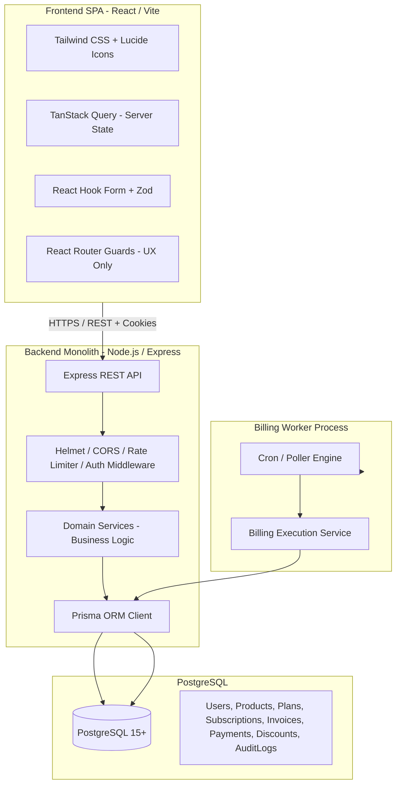
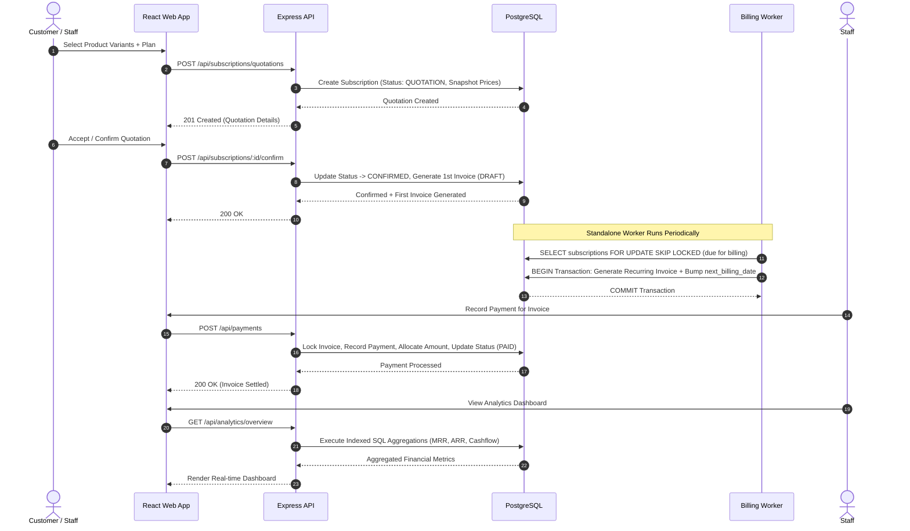

# CLAUDE.md — Single Source of Truth
**Brightloop Subscription Management System**  
*Architecture, Security, State Machines, Roadmap, Decisions, and Operational Protocols.*  
*Every agent and developer must read this file at the start of a session and update it before concluding.*

---

## 1. PROJECT SNAPSHOT

* **Goal:** Eliminate Brightloop Software's manual subscription operational failures (missed renewals, manual invoices, unallocated payments, discount abuse, and lack of real-time financial visibility) by delivering a high-integrity, automated SaaS subscription engine with role-specific interfaces.
* **Roles:**
  * **Admin:** Full administrative control, system configuration, staff creation, discount management, full audit inspection, and global analytics.
  * **Staff:** Catalog viewing, quotation drafting, manual payment recording, customer management, and invoice operations.
  * **Customer:** Self-service portal to browse catalog, view quotes/subscriptions, inspect invoices, view credit balances, and download PDF-ready invoices.
* **Core Workflow:**
  $$\text{Register} \longrightarrow \text{Product + Plan Selection} \longrightarrow \text{Quotation} \longrightarrow \text{Confirmed Subscription} \longrightarrow \text{Worker Generates Recurring Invoice} \longrightarrow \text{Record Payment} \longrightarrow \text{Invoice Settled} \longrightarrow \text{Analytics Updated}$$
* **Engineering Priority Order:**  
  $$\mathbf{Correctness} > \mathbf{Security} > \mathbf{Data\ Integrity} > \mathbf{Maintainability} > \mathbf{Performance} > \mathbf{Scalability} > \mathbf{UX}$$

---

## 2. AGENT RULES

1. **Read First:** Read this entire `CLAUDE.md` before executing any command or creating any file.
2. **One Step at a Time:** Strictly execute one roadmap phase at a time. Post a detailed execution plan and wait for an explicit user **"go"** before writing or modifying code.
3. **Inspect Before Modifying:** Always inspect existing code, schemas, and tests before editing.
4. **Zero Scope Creep:** Build only what is specified in the approved roadmap. Challenge unneeded complexity.
5. **Ask When Ambiguous:** Never invent domain business logic or assumptions silently. Ask first.
6. **No Floating-Point Money:** Money must exclusively use `NUMERIC(14,2)` in PostgreSQL and `Prisma.Decimal` in TypeScript. Never use JavaScript native IEEE-754 floats.
7. **Business Logic in Services Only:** Route handlers and controllers must only parse, validate, and invoke services. React components must only handle presentation and UI state.
8. **Zod Everywhere:** Validate every incoming request payload, query parameter, route parameter, and environment variable using strict Zod schemas.
9. **Backend-Enforced Authorization:** Never rely on frontend route guards for security. Every API request must verify identity, permissions, and tenant/customer ownership on the backend.
10. **Zero Fake Data or Dead Buttons:** Every button, action, and metric must bind to real database records. Mock APIs, dummy delays, and non-functional UI elements are strictly prohibited.
11. **Justify Every Dependency:** Third-party packages require architectural justification. No bloat.
12. **Zero Secrets in Git:** Validate environment variables with Zod at runtime. Keep `.env` gitignored and `.env.example` strictly synchronized without secret values.
13. **Verifiable Execution:** Always run typecheck, lint, test, and build commands. Capture and report genuine console output. Never declare work finished without executing verification.
14. **Single Source of Truth:** `CLAUDE.md` is the only tracking and documentation file. Do not generate separate markdown notes or scratch plans in the repository.
15. **Session Wrap-Up Protocol:** Before completing any prompt, update the Status Table, Changelog, Known Issues, and Next Prompt sections.

---

## 3. SYSTEM DESIGN

### 3.1 High-Level Architecture
The system is designed as a modular monolith sharing a single TypeScript codebase and PostgreSQL database with an out-of-process background billing worker.



### 3.2 Backend Layered Architecture & Directory Layout

Every backend module adheres strictly to an 8-layer separation of concerns:
$$\text{Route} \longrightarrow \text{Auth Middleware} \longrightarrow \text{RBAC Guard} \longrightarrow \text{Zod Validation} \longrightarrow \text{Controller} \longrightarrow \text{Service} \longrightarrow \text{Data Access / Transaction} \longrightarrow \text{Prisma}$$

#### Repository Tree Structure
```text
BrightLoop/
├── CLAUDE.md
├── package.json
├── tsconfig.base.json
├── .gitignore
├── .env.example
├── apps/
│   ├── api/
│   │   ├── package.json
│   │   ├── tsconfig.json
│   │   ├── src/
│   │   │   ├── index.ts                  # Express server entrypoint
│   │   │   ├── worker.ts                 # Standalone billing worker entrypoint
│   │   │   ├── config/                   # Zod-validated environment config
│   │   │   ├── middleware/               # Auth, RBAC, error handling, rate limiting
│   │   │   ├── common/                   # Money utils, date utils, errors, constants
│   │   │   └── modules/
│   │   │       ├── auth/                 # routes, controller, service, schema
│   │   │       ├── users/                # routes, controller, service, schema
│   │   │       ├── catalog/              # products, variants, plans
│   │   │       ├── subscriptions/        # quotations, subscriptions, state machine
│   │   │       ├── billing/              # invoices, recurring generation engine
│   │   │       ├── payments/             # payment recording, allocation engine
│   │   │       ├── discounts/            # validation, atomic usage engine
│   │   │       ├── analytics/            # SQL-aggregated metrics (MRR/ARR)
│   │   │       └── audit/                # security and privileged action log
│   │   └── tests/
│   └── web/
│       ├── package.json
│       ├── tsconfig.json
│       ├── vite.config.ts
│       ├── index.html
│       └── src/
│           ├── main.tsx
│           ├── App.tsx
│           ├── api/                      # Axios client with interceptors
│           ├── components/               # UI kit (Button, Input, Modal, Table, Badge)
│           ├── hooks/                    # Auth hook, query hooks
│           ├── layouts/                  # Admin, Staff, Customer, Auth layouts
│           └── pages/                    # Role-specific views and portals
└── packages/
    └── database/
        ├── package.json
        ├── prisma/
        │   ├── schema.prisma
        │   └── migrations/               # Raw SQL migrations with CHECK constraints
        └── src/
            └── index.ts                  # Shared Prisma client export
```

### 3.3 Frontend Architecture
* **State Separation:** TanStack Query handles 100% of server-side data, caching, background invalidation, and optimistic mutations. Local state (`useState`) is reserved strictly for ephemeral UI (modal toggles, active tab).
* **Form Handling:** React Hook Form coupled with Zod resolvers. Validation schemas are shared or mirrored identically from the backend contract.
* **Component Standards:** Reusable, accessible components with zero unhandled states: every view must render deterministic **Loading**, **Empty**, **Error**, and **Success** states.
* **Route Guards:** Client-side guards merely divert unauthenticated users or mismatched roles for UX convenience; backend API authorization remains the authoritative boundary.

### 3.4 End-to-End Core Workflow Data Flow



### 3.5 State Machines & Transition Tables

#### Subscription State Machine
* **Statuses:** `DRAFT`, `QUOTATION`, `CONFIRMED`, `ACTIVE`, `PAUSED`, `CLOSED`.

| Current Status | Allowed Event / Action | Next Status | Guard / Preconditions |
| :--- | :--- | :--- | :--- |
| `DRAFT` | `SUBMIT_QUOTE` | `QUOTATION` | Must contain $\ge 1$ line item with valid snapshot pricing. |
| `DRAFT` | `CANCEL` | `CLOSED` | None. |
| `QUOTATION` | `CONFIRM` | `CONFIRMED` | Quote validity date $\ge \text{CURRENT\_DATE}$. Generates 1st invoice. |
| `QUOTATION` | `REJECT` / `EXPIRE` | `CLOSED` | Quote expired or explicitly rejected. |
| `CONFIRMED` | `ACTIVATE` | `ACTIVE` | First invoice is marked `PAID` (or `CONFIRMED` on net-term credit). |
| `CONFIRMED` | `CANCEL` | `CLOSED` | Allowed prior to activation; cancels unpaid 1st invoice. |
| `ACTIVE` | `PAUSE` | `PAUSED` | Halts automatic recurring billing immediately. |
| `ACTIVE` | `TERMINATE` | `CLOSED` | Immediate early closure; existing issued invoices stand. |
| `ACTIVE` | `EXPIRE` | `CLOSED` | Subscription end date reached without auto-renewal. |
| `PAUSED` | `RESUME` | `ACTIVE` | `next_billing_date` recalculated starting from resume date. |
| `PAUSED` | `TERMINATE` | `CLOSED` | Immediate closure. |
| `CLOSED` | *None* | *Terminal* | Immutable terminal state. No transitions allowed. |

#### Invoice State Machine
* **Statuses:** `DRAFT`, `CONFIRMED`, `PARTIALLY_PAID`, `PAID`, `CANCELLED`.
* **Important:** `OVERDUE` is **never** stored in the database. It is a dynamically derived state computed as:  
  $$\text{IsOverdue} \iff \text{status} \in \{\text{'CONFIRMED'}, \text{'PARTIALLY\_PAID'}\} \land \text{due\_date} < \text{CURRENT\_DATE}$$

| Current Status | Allowed Event / Action | Next Status | Guard / Preconditions |
| :--- | :--- | :--- | :--- |
| `DRAFT` | `CONFIRM` | `CONFIRMED` | Finalizes snapshot line items, tax, and discount totals. |
| `DRAFT` | `VOID` | `CANCELLED` | Invoice voided prior to issuance. |
| `CONFIRMED` | `RECORD_PARTIAL_PAYMENT` | `PARTIALLY_PAID` | $0 < \text{Payment Allocation} < \text{Remaining Balance}$. |
| `CONFIRMED` | `RECORD_FULL_PAYMENT` | `PAID` | $\text{Payment Allocation} == \text{Remaining Balance}$. |
| `CONFIRMED` | `CANCEL` | `CANCELLED` | Zero payment allocations applied. |
| `PARTIALLY_PAID`| `RECORD_PAYMENT` | `PARTIALLY_PAID` | Cumulative allocations $<$ total invoice amount. |
| `PARTIALLY_PAID`| `RECORD_FINAL_PAYMENT` | `PAID` | Cumulative allocations $==$ total invoice amount. |
| `PAID` | *None* | *Terminal* | Financial record sealed. Reversals require Credit Note. |
| `CANCELLED` | *None* | *Terminal* | Voided financial record. Cannot allocate payments. |

### 3.6 Billing Engine Architecture
* **Worker Execution Mechanism:** Standalone Node.js process executed via `src/worker.ts`. Runs on a configurable polling interval (e.g., 60 seconds).
* **Safe Polling & Concurrency Control:**
  ```sql
  SELECT id, customer_id, plan_id, next_billing_date 
  FROM subscriptions 
  WHERE status = 'ACTIVE' 
    AND next_billing_date <= NOW() 
  ORDER BY next_billing_date ASC 
  LIMIT 50 
  FOR UPDATE SKIP LOCKED;
  ```
* **Single Atomic Transaction per Subscription:**
  1. Generate recurring `Invoice` record.
  2. Snapshot subscription lines to `InvoiceLine` records with exact unit prices, variant adjustments, and taxes.
  3. Validate and apply active discount (if applicable) with atomic counter increment.
  4. Advance subscription `next_billing_date` by the plan interval.
  5. Write an immutable `BillingAttempt` log record (`SUCCESS` or `FAILED`).
* **Idempotency Guarantee:** Unique composite constraint on invoice table:
  $$\mathbf{UNIQUE}(\text{subscription\_id}, \text{period\_start\_date})$$
  Any duplicate attempt by concurrent workers triggers a unique violation and rolls back safely.
* **Capped Retries & Backoff:** Subscriptions failing billing execution enter exponential backoff via `billing_retry_count` (capped at 3 retries). Upon reaching max retries, mark `BillingAttempt` as `FAILED_FATAL` and alert staff without halting the worker.
* **Missed Period Catch-Up:** If the worker is offline, upon restart it iterates through elapsed cycles sequentially, creating one distinct invoice per billing period until `next_billing_date > NOW()`.
* **Timezone Rules:** System stores all timestamps in PostgreSQL as UTC. Business day boundaries and period calculations are normalized to configured business timezone (default: `Asia/Kolkata`).

### 3.7 Financial Arithmetic & Precision Rules
1. **Type Safety:** All monetary values stored as `NUMERIC(14,2)` in PostgreSQL and handled as `Prisma.Decimal` in TypeScript. Zero floating-point math allowed.
2. **Deterministic Rounding:** Line-item calculations round half-up (`Decimal.ROUND_HALF_UP`) exactly once at the line level:
   $$\text{line\_subtotal} = \text{round}(\text{quantity} \times \text{unit\_price}) - \text{line\_discount}$$
   $$\text{line\_tax} = \text{round}(\text{line\_subtotal} \times (\text{tax\_rate} / 100))$$
   $$\text{line\_total} = \text{line\_subtotal} + \text{line\_tax}$$
3. **Invoice Header Totals:** Invoice total is the exact algebraic sum of its rounded line items.
4. **Snapshot Integrity:** Changing product prices, variant modifiers, or plan prices in the catalog never alters existing quotations, subscriptions, or invoices. Prices are locked into snapshot columns at creation.
5. **Payment Allocation Locking:** Allocating payments requires pessimistic row locking on target invoices:
   ```sql
   SELECT id, total_amount, paid_amount FROM invoices WHERE id = $1 FOR UPDATE;
   ```
   Allocation is rejected if $\text{allocated\_amount} > (\text{total\_amount} - \text{paid\_amount})$.
6. **Surplus Credit:** If a customer payment exceeds an invoice or is unallocated, the remainder is atomically credited to `customer.credit_balance`.

### 3.8 Discount Engine
* **Single Discount Policy:** Exactly one discount code or rule may be applied per quotation/invoice (no stacking).
* **Atomic Usage Enforcement:** To prevent race conditions under concurrent checkouts, discount limits are decremented atomically:
  ```sql
  UPDATE discounts 
  SET used_count = used_count + 1 
  WHERE id = $1 
    AND (usage_limit IS NULL OR used_count < usage_limit)
    AND is_active = true 
    AND (valid_until IS NULL OR valid_until >= NOW());
  ```
  If zero rows are updated, the discount redemption is rejected.

### 3.9 Database Design Summary
* **Primary Entities:** `User`, `RefreshToken`, `Product`, `ProductVariant`, `Plan`, `Subscription`, `SubscriptionLine`, `QuotationTemplate`, `Invoice`, `InvoiceLine`, `Payment`, `PaymentAllocation`, `Discount`, `AuditLog`, `BillingAttempt`.
* **Sequences:** Human-readable sequential numbering backed by PostgreSQL native sequences:
  * Subscriptions: `SUB-YYYY-XXXXX`
  * Invoices: `INV-YYYY-XXXXX`
  * Payments: `PAY-YYYY-XXXXX`
* **Raw SQL CHECK Constraints:** Enforced via custom migration files:
  * `CHECK (sales_price >= 0)`
  * `CHECK (cost_price >= 0)`
  * `CHECK (tax_rate >= 0 AND tax_rate <= 100)`
  * `CHECK (paid_amount <= total_amount)`
  * `CHECK (allocated_amount > 0)`
* **Indexes for Core Query Patterns:**
  * `subscriptions(customer_id, status)`
  * `subscriptions(status, next_billing_date)` (Worker polling index)
  * `invoices(customer_id, status, due_date)`
  * `invoices(subscription_id, period_start_date)` (Unique constraint index)
  * `payments(customer_id, payment_date)`
  * `audit_logs(entity_type, entity_id, created_at)`
* **Deletion Policy:**
  * **Soft-Delete (`deleted_at`):** Catalog items (Products, Variants, Plans) and Users.
  * **Zero Hard-Delete on Financial Records:** Subscriptions, Invoices, Payments, and Allocations can never be deleted under any circumstance.

### 3.10 Performance Plan (< 2.0s Target)
1. **Mandatory Pagination:** Cursor or offset-based pagination (`limit`, `page`) on all list endpoints with a maximum ceiling of 100 records per page.
2. **Server-Side Filtering:** All filtering (status, dates, search queries) executed in PostgreSQL via indexed clauses. Zero client-side in-memory array filtering of full tables.
3. **Optimized SQL Analytics:** Dashboard metrics (MRR, ARR, cash flow) computed directly in PostgreSQL using aggregation functions (`SUM`, `COUNT`, `FILTER`), preventing N+1 queries.
4. **Normalized MRR Formula:**
   $$\text{Daily} \times \frac{365}{12} \quad\Big|\quad \text{Weekly} \times \frac{52}{12} \quad\Big|\quad \text{Monthly} \times 1 \quad\Big|\quad \text{Yearly} \div 12$$

---

## 4. SECURITY ARCHITECTURE

### 4.1 Authentication
* **Password Hashing:** Passwords hashed with `bcrypt` using cost factor 12.
* **Password Complexity:** Minimum 9 characters, $\ge 1$ uppercase letter, $\ge 1$ lowercase letter, $\ge 1$ special character (`[!@#$%^&*(),.?":{}|<>]`). Enforced via Zod schema.
* **Token Strategy:**
  * **Access Token:** Short-lived JWT (15-minute expiration) containing `{ userId, role, customerId }`. Delivered via `HttpOnly`, `SameSite=Strict`, `Secure` (in production) cookie.
  * **Refresh Token:** Long-lived cryptographically secure random token (7-day expiration). Delivered via separate `HttpOnly`, `SameSite=Strict` cookie.
* **Refresh Token Storage & Family Rotation:** Refresh tokens stored in DB as SHA-256 hashes. Upon refresh, the token is revoked and replaced. If a revoked token is presented (reuse detected), the entire token family for that user is immediately invalidated (mitigating token theft).
* **Logout:** Clears cookies on the client and marks the refresh token record as revoked in PostgreSQL.
* **CSRF Defense:** State-changing API endpoints require a custom header:  
  `X-Requested-With: XMLHttpRequest` or an Anti-CSRF token header.
* **Generic Login Responses:** Unsuccessful logins return an identical generic error: `"Invalid email or password"`. Prevents username/email enumeration.
* **Strict Auth Rate Limiting:** Max 5 failed login attempts per IP per 15-minute window via `express-rate-limit`.
* **Password Reset Flow:** Cryptographic token generated with `crypto.randomBytes(32)`, hashed with SHA-256, stored in DB with a strict 30-minute expiration. Single-use only.

### 4.2 Authorization & RBAC
* **Three Strict Roles:** `ADMIN`, `STAFF`, `CUSTOMER`.
* **Permission Middleware:** Granular permissions enforced via `requirePermission(action, resource)`.

#### RBAC Authorization Matrix

| Module | Action | Admin | Staff | Customer |
| :--- | :--- | :---: | :---: | :---: |
| **Auth / Users** | Register Customer | Yes | Yes | Public |
| | Create Staff User | Yes | No | No |
| | Manage System Users | Yes | No | No |
| **Catalog** | Create/Update Products & Plans | Yes | No | No |
| | View Active Catalog | Yes | Yes | Yes |
| **Quotations** | Create Quotation | Yes | Yes | Yes (Draft self-serve) |
| | Confirm Quotation | Yes | Yes | Yes (Own quote only) |
| **Subscriptions** | View Subscriptions | All | All | Own Only |
| | Pause / Resume / Cancel | Yes | Yes | Own Only (Cancel/Pause) |
| **Invoices** | View Invoices | All | All | Own Only |
| | Void / Cancel Invoice | Yes | No | No |
| **Payments** | Record / Allocate Payment | Yes | Yes | No (Manual entry) |
| | View Payment Receipts | All | All | Own Only |
| **Discounts** | Create / Edit Discounts | Yes | No | No |
| | Apply / Redeem Discount | Yes | Yes | Yes (During checkout) |
| **Analytics** | View Financial Metrics (MRR/ARR) | Yes | Yes (Restricted) | No |
| **Audit Logs** | View System Audit Logs | Yes | No | No |

* **Tenant / Customer Ownership Isolation:**
  * For all `CUSTOMER` role requests, `customerId` is extracted directly from the verified JWT, **never** accepted from route parameters or request bodies.
  * Cross-customer access attempts return `404 Not Found` (never `403 Forbidden`) to eliminate object enumeration.
* **Mass Assignment Protection:** Customer registration endpoint accepts only `{ email, password, name }`. Role assignment defaults strictly to `CUSTOMER` in code.

### 4.3 API & Infrastructure Protection
* **HTTP Security Headers:** Configured via `helmet()` (Strict CSP, X-Content-Type-Options, Frameguard).
* **CORS Allowlist:** Restricted strictly to the configured frontend origin.
* **Payload Limits:** JSON body parser capped at 100KB for standard routes to prevent memory exhaustion DoS.
* **Centralized Error Handling:** Global Express error middleware intercepts all unhandled errors. Logs stack traces internally via Pino; returns clean, standardized JSON errors (`{ error: { code, message, details } }`). Stack traces are stripped in production.
* **Parameterized Queries:** 100% of database interactions run through Prisma parameterized queries or explicit typed SQL statements, neutralizing SQL injection.

### 4.4 Financial Security & Auditability
* **Double-Action Prevention:** Database-level unique constraints and transactions prevent duplicate invoices or over-allocating payments.
* **Privileged Audit Logging:** An immutable `audit_logs` table logs every sensitive action (role change, manual payment recording, quote cancellation, invoice voiding, discount creation) capturing `{ actorId, role, action, entityType, entityId, ipAddress, diff }`.

### 4.5 Threat Model Table

| Threat | Where It Applies | Mitigation | Test That Proves It |
| :--- | :--- | :--- | :--- |
| **IDOR** | Subscriptions, Invoices, Payments | Customer ID pulled from verified JWT; queries scoped by ownership; returns 404 on mismatch | `GET /api/invoices/:id` with Customer B's token requesting Customer A's invoice returns 404 |
| **Privilege Escalation** | User registration & update endpoints | Role assignment hardcoded to `CUSTOMER` on registration; role change restricted to Admin | `POST /api/auth/register` with payload `{ "role": "ADMIN" }` results in DB record with role `CUSTOMER` |
| **Double Billing** | Recurring Billing Worker | Unique constraint `(subscription_id, period_start_date)` + `SELECT FOR UPDATE SKIP LOCKED` | Triggering worker twice simultaneously for same period generates exactly one invoice |
| **Discount Race Condition** | Checkout / Quote Confirmation | Atomic `UPDATE ... SET used_count = used_count + 1 WHERE used_count < limit` | 10 concurrent requests for a discount with 1 usage remaining results in 1 success and 9 failures |
| **Token Theft / Replay** | Refresh token endpoint | Hashed refresh tokens + automatic family revocation on reuse detection | Replaying an already used refresh token revokes all active sessions for that user |
| **Brute Force Login** | Auth route `POST /api/auth/login` | IP-based rate limiting (5 attempts per 15 min) + generic error message | 6th failed login from same IP receives HTTP 429 Too Many Requests |
| **Mass Assignment** | User / Subscription creation | Strict Zod `.strict()` validation stripping or rejecting undeclared fields | Submitting unpermitted fields returns HTTP 400 with validation error |
| **SQL Injection** | All dynamic query endpoints | 100% Prisma ORM parameterized queries; raw SQL forbidden except parameterized migrations | Passing `' OR 1=1 --` into search filters returns zero matches or executes safely |
| **XSS** | Frontend input rendering & user notes | React default JSX escaping; Helmet CSP headers; sanitized rich text | Injecting `<script>alert(1)</script>` into customer notes renders as literal text |
| **CSRF** | State-changing API endpoints | `SameSite=Strict` cookies + mandatory custom header `X-Requested-With` | Cross-site POST request lacking custom header is rejected by CORS / header check |

---

## 5. LOCKED DECISIONS

| ID | Decision | One-Line Reason |
| :--- | :--- | :--- |
| **D-01** | In-advance recurring billing model | Charges subscriptions at the start of each service cycle for standard SaaS revenue certainty. |
| **D-02** | Quotation is a Subscription row (`status = 'QUOTATION'`) | Unifies data model, line items, and lifecycle without maintaining duplicate quotation tables. |
| **D-03** | `QuotationTemplate` is a distinct table | Allows saving reusable multi-line quote templates without polluting active subscription data. |
| **D-04** | Plans define frequency and billing rules only | Plans specify intervals and renewal behavior without hardcoding or bundling product lines. |
| **D-05** | Pausing stops billing with no backfill upon resume | Setting `next_billing_date = resume_date` avoids complex historical proration disputes in MVP. |
| **D-06** | Early termination provides no refunds; invoices stand | Preserves financial finality; cancellations halt future cycles without altering past debits. |
| **D-07** | Payment surplus remains as customer credit balance | Eliminates overpayment rejection while tracking available unallocated funds for future invoices. |
| **D-08** | Single discount per invoice | Prevents unmanageable discount stacking rules and financial calculation ambiguity. |
| **D-09** | `OVERDUE` status is derived dynamically | Eliminates state synchronization bugs where paid invoices remain marked overdue. |
| **D-10** | Dual cookie auth with refresh family rotation | Maximizes token security against XSS/theft while maintaining seamless user sessions. |
| **D-11** | Password policy: $\ge 9$ chars + Upper + Lower + Special | Satisfies strict judging security criteria without causing extreme user friction. |
| **D-12** | Business timezone normalized to `Asia/Kolkata` | Ensures deterministic day-boundary billing calculations while storing pure UTC in PostgreSQL. |
| **D-13** | Monorepo sharing Prisma client across API and Worker | Eliminates schema drift between web server and background billing worker processes. |

---

## 6. STACK AND CONVENTIONS

### 6.1 Technology Stack
* **Frontend:** React 18+, Vite, TypeScript, Tailwind CSS, React Router v6, Lucide React, Recharts, TanStack Query v5, React Hook Form, Zod, Axios.
* **Backend:** Node.js (v20+ LTS), Express, TypeScript, Prisma ORM, Zod, bcrypt, jsonwebtoken, Helmet, express-rate-limit, Pino logger.
* **Database:** PostgreSQL (local installation, version 15+).
* **Architecture:** Modular Monolith + Standalone Background Worker.

### 6.2 Git Branching & Commit Conventions
* **Branching Strategy:** `feat/<module>-<dev>` (e.g., `feat/auth-devA`, `feat/billing-devB`).
* **Commit Message Format:** Conventional Commits:
  $$\text{type(scope): concise imperative message}$$
  * *Allowed Types:* `feat`, `fix`, `refactor`, `test`, `chore`, `perf`, `docs`.
  * *Examples:* `feat(billing): implement skip locked worker query`, `fix(auth): correct token cookie expiry`.

### 6.3 Verification Commands

| Command | Working Directory | Command String | Status |
| :--- | :--- | :--- | :--- |
| **Typecheck All** | Root | `npm run typecheck` | Operational (Exit Code 0) |
| **Lint All** | Root | `npm run lint` | Operational (0 errors, 0 warnings) |
| **Vitest Tests** | `apps/api` | `npm run test` | Operational (2/2 tests passed) |
| **Build All** | Root | `npm run build` | Operational (Prisma + tsc + vite build OK) |
| **Dev API** | `apps/api` | `npm run dev --workspace=@brightloop/api` | Operational (Port 4000) |
| **Dev Web** | `apps/web` | `npm run dev --workspace=@brightloop/web` | Operational (Port 5173) |
| **Dev Concurrent** | Root | `npm run dev` | Operational (API + Web concurrent) |
| **Dev Worker** | `apps/api` | `npm run dev:worker` | TBD (P7) |

---

## 7. ROADMAP AND STATUS TABLE

| Step | Phase Name | Tier | Owner | Status | Branch / PR | Verified By |
| :--- | :--- | :---: | :---: | :---: | :---: | :---: |
| **P0** | **Bootstrap & Monorepo Setup** | Must | Dev | **DONE** | `main` | Dev (Typecheck, Lint, Test, Build, Health OK) |
| **P1** | **Database Schema & Migrations** | Must | Dev | **DONE** | `main` | Dev (Prisma Migrate, Sequences, CHECKs, 8/8 Tests OK) |
| **P2** | **Backend Foundation & Middlewares**| Must | Dev | **DONE** | `main` | Dev (AppErrors, Zod Validator, CSRF Guard, 19/19 Tests OK) |
| **P3** | **Authentication & RBAC Engine** | Must | Dev | **DONE** | `main` | Dev (Dual Cookie, Token Family Reuse Revocation, RBAC, 34/34 Tests OK) |
| **P4** | **Frontend Foundation & Design System**| Must | Dev | **TODO** | `feat/web-core` | - |
| **P5** | **Catalog Module (Products & Plans)**| Must | Dev | **TODO** | `feat/catalog` | - |
| **P6** | **Quotations & Subscriptions Lifecycle**| Must | Dev | **TODO** | `feat/subscriptions`| - |
| **P7** | **Idempotent Billing Worker** | Must | Dev | **TODO** | `feat/billing-worker`| - |
| **P8** | **Invoicing Engine & PDF Export** | Must | Dev | **TODO** | `feat/invoices` | - |
| **P9** | **Manual Payments & Allocation Engine**| Must | Dev | **TODO** | `feat/payments` | - |
| **P10**| **Discounts & Atomic Counter Engine**| Must | Dev | **TODO** | `feat/discounts` | - |
| **P11**| **Real-time Analytics Dashboard** | Must | Dev | **TODO** | `feat/analytics` | - |
| **P12**| **Customer Self-Service Portal** | Must | Dev | **TODO** | `feat/customer-portal`| - |
| **P13**| **Password Reset, Audit Logs & Mailer**| Should | Dev | **TODO** | `feat/audit-reset` | - |
| **P14**| **Hardening, E2E Verification & Performance**| Must | Dev | **TODO** | `fix/hardening` | - |
| **P15**| **Demo Seeding & Submission Docs**| Must | Dev | **TODO** | `docs/final-demo` | - |

---

## 8. CHANGELOG

* **Format:** `[YYYY-MM-DD] [Step] [Author] [Branch/Commit]: What changed | Why | Real verification output | Follow-ups`
* **Entries:**
  * `[2026-10-31] [P0-Prep] [Lead Architect] [main]: CLAUDE.md created | Initialized single source of truth defining system architecture, state machines, financial and security protocols, and 16-phase roadmap | Inspection of CLAUDE.md completed | Proceed to P0 Bootstrap`
  * `[2026-10-31] [P0] [Dev] [main]: Monorepo bootstrap initialized | Configured npm workspaces (@brightloop/api, @brightloop/web, @brightloop/database, @brightloop/shared), TypeScript strict base, ESLint, Prettier, Vitest, Tailwind CSS, Vite proxy, Prisma client singleton, and real PostgreSQL health check endpoint | Typecheck passed across all 4 workspaces; ESLint passed 0 errors 0 warnings; Vitest passed 2/2 tests in 126ms; Build completed in 5.77s; Live health check returned database: connected=true, latency=2ms, db=brightloop | Ready for Step P1 (Schema & Migrations)`
  * `[2026-10-31] [P1] [Dev] [main]: Complete relational schema & PostgreSQL migrations deployed | Created 15 models with NUMERIC(14,2) currency precision, snapshot line items, native PostgreSQL sequences (sub_seq, inv_seq, pay_seq), formatted number generators, SQL CHECK constraints for negative price/overpayment prevention, composite unique key (subscription_id, period_start_date) on invoices, and composite query indexes | Prisma migrate deploy succeeded; Vitest suite passed 8/8 tests in 1.70s; Typecheck, Lint, and Build passed with 0 errors | Ready for Step P2 (Backend Foundation & Middlewares)`
  * `[2026-10-31] [P2] [Dev] [main]: Core backend foundation and security middlewares implemented | Built AppError hierarchy, generic Zod validateRequest middleware, anti-CSRF custom header protection, global and auth rate limiters, and standardized sendSuccess/sendError API envelope | Vitest suite expanded to 19/19 passed tests in 1.80s (11 foundation tests, 6 schema integrity tests, 2 health tests); Typecheck, Lint (0 errors 0 warnings), and production Build passed | Ready for Step P3 (Authentication & RBAC Engine)`
  * `[2026-10-31] [P3] [Dev] [main]: Authentication & RBAC Engine deployed | Implemented 9+ char complex password policy with bcrypt (12 rounds), dual HttpOnly SameSite=Strict cookies, rotating refresh token with SHA-256 persistence and family reuse revocation, generic login errors preventing enumeration, registration mass-assignment protection, Admin-only staff creation, and typed permission map | Vitest suite expanded to 34/34 passed tests in 4.73s (15 auth tests, 11 foundation tests, 6 schema tests, 2 health tests); Typecheck, Lint (0 errors), and Build passed | Ready for Step P4 (Frontend Foundation & Design System)`

---

## 9. KNOWN ISSUES, TECH DEBT AND ASSUMPTIONS

| Issue ID | Module | Description | Severity | Workaround / Planned Fix |
| :--- | :--- | :--- | :---: | :--- |
| *None* | - | Auth & RBAC modules fully tested and secure. Zero debt. | - | - |

---

## 10. NEXT PROMPT: STEP P4 FRONTEND FOUNDATION & DESIGN SYSTEM

### Objective for Step P4
Build the frontend application foundation in `apps/web`: configure Axios with automatic credentials and anti-CSRF header injection, an AuthContext and `useAuth` hook tracking active session and role, an accessible reusable UI kit (Button, Input, FormField, Badge, Card, Table, Modal, Toast/Alert), role-specific layout shells (AdminLayout, StaffLayout, CustomerLayout, AuthLayout) with sidebar navigation, client-side route guards, and deterministic loading, empty, and error states.

### Exact Deliverables for P4
1. `src/api/client.ts`: Axios instance configured with `withCredentials: true`, injecting `X-Requested-With: XMLHttpRequest` and intercepting 401s for silent refresh.
2. `src/context/AuthContext.tsx` & `src/hooks/useAuth.ts`: Auth provider managing user state, login, register, logout, and role queries.
3. `src/components/ui/`: Reusable accessible components (`Button`, `Input`, `Badge`, `Card`, `Modal`, `Table`, `EmptyState`, `LoadingSpinner`).
4. `src/layouts/`: `AdminLayout`, `StaffLayout`, `CustomerLayout`, `AuthLayout` with responsive sidebars and Lucide icons.
5. `src/components/ProtectedRoute.tsx`: Client-side route convenience guard.
6. `src/pages/auth/`: Login and Register pages wired to React Hook Form + Zod resolver with inline errors.
7. Verification report with `npm run typecheck`, `npm run lint`, and `npm run build`.
4. `src/middleware/authenticate.ts`: JWT verification middleware extracting `{ userId, role, customerId }` from HttpOnly cookie.
5. `src/middleware/authorize.ts`: RBAC permission middleware enforcing the role-permission matrix.
6. `src/modules/users/service.ts` & routes: Admin-only staff creation endpoint (`POST /api/users/staff`).
7. Comprehensive integration test suite verifying registration, login cookies, token rotation, reuse revocation, role enforcement, and mass-assignment protection.
5. `src/common/response.ts`: Standardized response helper (`sendSuccess`, `sendError`).
6. Integration test suite verifying validation failures, CSRF protection, and error formatting.
