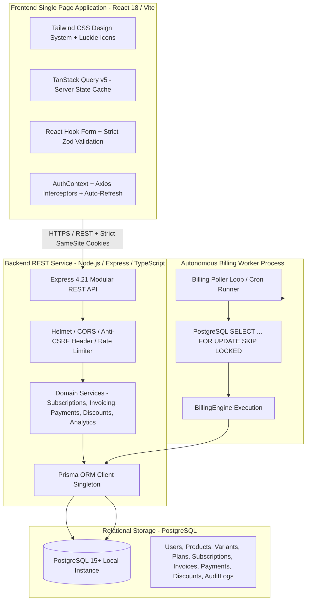

# Brightloop Subscription Management System

[](#verification--quality-gates)
[](#verification--quality-gates)
[](#architecture--workspaces)
[](#relational-integrity--financial-rules)

An enterprise-grade, modular monolith SaaS subscription and recurring billing management platform built to eliminate manual operational failures—missed renewals, inaccurate invoicing, unallocated payments, discount abuse, and fragmented financial visibility.

The platform provides an automated background billing engine, dual HttpOnly cookie authentication with token family rotation, anti-CSRF custom header validation, and a multi-role React 18 single-page application tailored for **Administrators**, **Staff**, and **Customer Self-Service**.

---

## Table of Contents

- [Architectural Overview](#architectural-overview)
- [Monorepo Workspaces](#monorepo-workspaces)
- [Relational Integrity & Financial Rules](#relational-integrity--financial-rules)
- [State Machines](#state-machines)
- [Prerequisites & Environment](#prerequisites--environment)
- [Quickstart Guide](#quickstart-guide)
- [Pre-configured Demo Accounts](#pre-configured-demo-accounts)
- [Interactive Role Workflows & Demo Scenarios](#interactive-role-workflows--demo-scenarios)
- [Verification & Quality Gates](#verification--quality-gates)

---

## Architectural Overview



### Key Engineering Principles
1. **Zero Scope Creep & Modular Monolith:** Single codebase sharing database models, validation schemas, and domain types across API and worker.
2. **Backend-Enforced Authorization:** Every incoming API request validates identity, permissions, and tenant ownership on the backend. Frontend route guards exist purely for UX.
3. **Audit Trail Completeness:** All sensitive financial transitions (surplus creation, credit applications, password resets, cancellations) write immutable records to `AuditLog`.

---

## Monorepo Workspaces

The codebase is structured as an npm workspaces monorepo:

```text
BrightLoop/
├── packages/
│   ├── database/               # Relational Prisma schema, migrations, and seed script
│   │   ├── prisma/
│   │   │   ├── schema.prisma   # 15 relational models with CHECK constraints & sequences
│   │   │   ├── migrations/     # Version-controlled SQL migrations
│   │   │   └── seed.ts         # Rich multi-account demo seeder script
│   │   └── src/index.ts        # Prisma client singleton export
│   └── shared/                 # Shared contracts between frontend and backend
│       └── src/                # Zod schemas, enums, DTOs, and permission maps
├── apps/
│   ├── api/                    # Express REST API monolith & standalone billing worker
│   │   ├── src/
│   │   │   ├── index.ts        # Express server entrypoint (Port 4000)
│   │   │   ├── worker.ts       # Standalone background billing worker entrypoint
│   │   │   ├── common/         # Pino logger, money arithmetic, error hierarchy, mailer
│   │   │   ├── middleware/     # Auth, RBAC, anti-CSRF, rate limiters, errorHandler
│   │   │   └── modules/        # auth, catalog, subscriptions, billing, invoices, payments, discounts, analytics, audit, users
│   │   └── tests/              # 14 Vitest integration test suites (147 tests)
│   └── web/                    # React 18 SPA (Vite + Tailwind CSS + TanStack Query)
│       └── src/
│           ├── components/     # UI Design system (Button, Modal, Table, Badge, Card, etc.)
│           ├── layouts/        # AdminLayout, StaffLayout, CustomerLayout, AuthLayout
│           ├── pages/          # Role-specific workbenches, dashboards, and portals
│           └── services/       # Axios API client with CSRF header injection & refresh queue
├── CLAUDE.md                   # Single source of truth (architecture, decisions, roadmap)
├── package.json                # Monorepo root scripts & dev dependencies
└── tsconfig.base.json          # Shared strict TypeScript configuration
```

---

## Relational Integrity & Financial Rules

| Decision ID | Rule | Implementation & Guarantee |
| :--- | :--- | :--- |
| **D-01** | **Zero Floating-Point Money** | All monetary values are strictly `NUMERIC(14,2)` in PostgreSQL and `Prisma.Decimal` in TypeScript. Floating-point math is prohibited. |
| **D-02** | **Unified Subscription Model** | Quotations are subscriptions with `status = 'QUOTATION'`. No duplicate quotation tables; seamless one-click confirmation. |
| **D-04** | **Configurable Product Variants** | Variants support positive and negative price adjustments (e.g. Dedicated Cloud adds +₹500.00). |
| **D-05** | **Pause Without Retroactive Backfill** | Resuming a paused subscription advances `nextBillingDate` to the resume date, avoiding proration disputes. |
| **D-06** | **Early Termination Finality** | Terminating a subscription cancels future billing cycles immediately; existing issued invoices stand. |
| **D-07** | **Payment Surplus as Customer Credit** | Overpayments are automatically credited to `User.creditBalance` and can be applied to settle future invoices. |
| **D-08** | **Single Discount per Invoice** | Strictly one coupon per invoice. Atomic conditional SQL (`UPDATE ... WHERE used_count < usage_limit RETURNING *`) eliminates race conditions under concurrent load. |
| **D-09** | **Dynamically Derived Overdue State** | `OVERDUE` is **never** stored in the database. It is evaluated dynamically: `(status IN ('CONFIRMED', 'PARTIALLY_PAID')) AND dueDate < NOW()`. |
| **D-10** | **Dual HttpOnly Cookie Auth** | 15-minute access token + 7-day refresh token stored in `HttpOnly, SameSite=Strict` cookies. Refresh token family rotation revokes all tokens upon detected reuse. |
| **D-11** | **Strict Password Policy** | Passwords require $\ge 9$ characters with uppercase, lowercase, numbers, and special characters. |
| **D-12** | **PostgreSQL Native Sequences** | Formatted sequence numbers for Subscriptions (`SUB-YYYY-XXXXX`), Invoices (`INV-YYYY-XXXXX`), and Payments (`PAY-YYYY-XXXXX`). |
| **D-13** | **Idempotent Billing Concurrency** | Physical composite unique constraint `UNIQUE(subscription_id, period_start_date)` on `invoices` combined with `SELECT ... FOR UPDATE SKIP LOCKED` guarantees non-duplicate billing. |

---

## State Machines

### Subscription Lifecycle
$$\text{DRAFT} \longrightarrow \text{QUOTATION} \xrightarrow{\text{Confirm}} \text{CONFIRMED} \xrightarrow{\text{Activate}} \text{ACTIVE} \underset{\text{Resume}}{\overset{\text{Pause}}{\rightleftharpoons}} \text{PAUSED} \xrightarrow{\text{Terminate}} \text{CLOSED}$$

### Invoice Lifecycle
$$\text{CONFIRMED} \xrightarrow{\text{Partial Payment}} \text{PARTIALLY\_PAID} \xrightarrow{\text{Final Payment}} \text{PAID}$$
$$\text{CONFIRMED} \xrightarrow[\text{Zero Payments Only}]{\text{Void}} \text{CANCELLED}$$
$$\text{Overdue Status} \iff \text{status} \in \{\text{'CONFIRMED'}, \text{'PARTIALLY\_PAID'}\} \land \text{dueDate} < \text{CURRENT\_TIMESTAMP}$$

---

## Prerequisites & Environment

- **Node.js:** v20+ LTS (Tested on Node.js v24.16.0)
- **PostgreSQL:** v15+ (Local instance running on port 5432)
- **Package Manager:** npm v10+

### Environment Configuration

Configure your environment variables in `.env`:

```env
PORT=4000
NODE_ENV=development
DATABASE_URL="postgresql://<username>:<password>@localhost:5432/brightloop?schema=public"
JWT_ACCESS_SECRET="your-jwt-access-secret-minimum-32-chars-long"
JWT_REFRESH_SECRET="your-jwt-refresh-secret-minimum-32-chars-long"
CORS_ORIGIN="http://localhost:5173"
BUSINESS_TIMEZONE="Asia/Kolkata"
```

In `apps/web/.env`:
```env
VITE_API_URL=http://localhost:4000/api
```

---

## Quickstart Guide

### 1. Install Workspace Dependencies
```bash
npm install
```

### 2. Run Database Migrations
Deploy the relational schema, sequences, triggers, and SQL CHECK constraints:
```bash
npx prisma migrate deploy --schema=packages/database/prisma/schema.prisma
```

### 3. Seed Realistic Demo Data
Populate demo users, catalog items, subscriptions, multi-status invoices, payments, and audit logs:
```bash
npm run seed
```

### 4. Start Development Servers
Start both the Express API and Vite React frontend concurrently:
```bash
npm run dev
```
- **Frontend SPA:** [http://localhost:5173](http://localhost:5173)
- **API Health Endpoint:** [http://localhost:4000/api/health](http://localhost:4000/api/health)

### 5. (Optional) Run the Standalone Background Billing Worker
To run the background billing poller in a separate process:
```bash
npm run dev:worker
```

---

## Pre-configured Demo Accounts

All pre-seeded demo accounts share the uniform password: `Brightloop#2026!`

| Role | Email | Password | Pre-loaded Context / Demonstration Purpose |
| :--- | :--- | :--- | :--- |
| **Admin** | `admin@brightloop.io` | `Brightloop#2026!` | Full administrative access: Catalog, Discounts, Staff provisioning, Analytics, Audit Trail, and on-demand Billing worker trigger. |
| **Staff** | `staff@brightloop.io` | `Brightloop#2026!` | Operational access: Quotation drafting, multi-invoice manual payment recording, customer management, and invoice operations. |
| **Customer** | `enterprise@acme.com` | `Brightloop#2026!` | **Enterprise Customer:** Holds an active subscription (`SUB-2026-00001`), historical paid invoices, and **₹1,500.00 credit balance** available to settle upcoming invoice `INV-2026-00003`. |
| **Customer** | `founder@startup.io` | `Brightloop#2026!` | **Startup Customer:** Has an open quotation (`SUB-2026-00003`) ready for one-click confirmation and a partially paid invoice (`INV-2026-00004`). |
| **Customer** | `finance@globex.org` | `Brightloop#2026!` | **Net-Terms Customer:** Holds confirmed invoice `INV-2026-00005` with a past due date, dynamically flagged as **`OVERDUE`**. |

---

## Interactive Role Workflows & Demo Scenarios

### Scenario 1: Apply Credit Balance to Settle an Invoice (Customer Self-Service)
1. Log in at `http://localhost:5173/login` as `enterprise@acme.com` (`Brightloop#2026!`).
2. Notice the **₹1,500.00 Available Credit** pill displayed in the top navbar and profile sidebar.
3. Navigate to **Invoices** (`/portal/invoices`).
4. Locate open invoice `INV-2026-00003` with status `CONFIRMED` and click **"Apply Credit"**.
5. Confirm the ₹1,500.00 allocation.
6. The invoice balance due immediately drops by ₹1,500.00, transitioning to `PARTIALLY_PAID`, and customer credit balance updates to ₹0.00.
7. Navigate to **Billing Profile** (`/portal/profile`) to inspect the chronological transaction statement ledger with the debit entry.

### Scenario 2: One-Click Quotation Confirmation (Customer Self-Service)
1. Log in as `founder@startup.io` (`Brightloop#2026!`).
2. Navigate to **My Subscriptions** (`/portal/subscriptions`).
3. Select quote `SUB-2026-00003` (AI Revenue Predictor) in `QUOTATION` status.
4. Click **"Confirm Quotation"**.
5. The quote immediately transitions to `CONFIRMED`, locking in snapshot line prices and generating the first recurring invoice.

### Scenario 3: Record Manual Payment with Surplus (Staff / Admin)
1. Log in as `staff@brightloop.io` (`Brightloop#2026!`).
2. Navigate to **Payments** (`/staff/payments`).
3. Click **"Record Payment"**.
4. Select customer `founder@startup.io`, enter Amount `₹1,000.00`, choose `Manual Bank Transfer`, and allocate ₹770.00 to settle open invoice `INV-2026-00004`.
5. Observe the live surplus calculation: ₹230.00.
6. Click **"Submit Payment"**:
   - Invoice `INV-2026-00004` status transitions to `PAID`.
   - The ₹230.00 surplus is credited to DevFlow's account.
   - An audit log is automatically generated for the surplus.

### Scenario 4: Autonomous Billing Worker Cycle & Idempotency (Admin)
1. Log in as `admin@brightloop.io` (`Brightloop#2026!`).
2. Navigate to **Invoices** (`/admin/invoices`).
3. Click **"Run Billing Cycle"**.
4. The backend BillingEngine executes `SELECT ... FOR UPDATE SKIP LOCKED`, processes active subscriptions due for renewal, generates sequential `INV-YYYY-XXXXX` invoices, advances `nextBillingDate`, and logs immutable `BillingAttempt` records.
5. Clicking the button again immediately demonstrates **idempotency**: 0 new duplicate invoices are generated.

### Scenario 5: Real-Time Financial Analytics & Aging Brackets (Admin / Staff)
1. Navigate to **Analytics** (`/admin/analytics`).
2. Inspect the live revenue metrics:
   - **Monthly Recurring Revenue (MRR):** Normalized across daily, weekly, monthly, and yearly frequencies.
   - **Annual Recurring Revenue (ARR):** Derived as $\text{MRR} \times 12$.
   - **Accounts Receivable (AR) Aging Brackets:** `Current`, `1-30 Days`, `31-60 Days`, `61-90 Days`, and `90+ Days` dynamically categorizing overdue balances (such as Globex invoice `INV-2026-00005`).

### Scenario 6: Security Audit Trail & Password Recovery
1. Navigate to **Audit Logs** (`/admin/audit-logs`) to inspect chronological logs of user registrations, status updates, payment surplus allocations, and credit deductions. Click **"Inspect"** to view JSON state deltas.
2. Visit `/forgot-password` to trigger password reset recovery with SHA-256 tokens and refresh token family invalidation.

---

## Verification & Quality Gates

The entire codebase has been systematically verified using real console executions across all quality gates:

| Verification Suite | Target Directory / Workspace | Command | Real Output / Result |
| :--- | :--- | :--- | :--- |
| **TypeScript Typecheck** | Root (all 4 workspaces) | `npm run typecheck` | **Passed:** Exit code 0 across `@brightloop/database`, `@brightloop/shared`, `@brightloop/api`, and `@brightloop/web`. |
| **ESLint Code Quality** | Root | `npm run lint` | **Passed:** 0 errors, 0 warnings. |
| **Integration Test Suites** | `apps/api` | `npm run test` | **Passed: 147/147 tests across 14 test files** in 29.47s. |
| **Production Build** | Root | `npm run build` | **Passed:** Prisma client generation + tsc + Vite production bundle in 4.34s. |
| **Database Seeding** | `packages/database` | `npm run seed` | **Passed:** Complete database reset, sequence alignment, and demo record generation in 2.8s. |
| **Live Database Health** | API | `GET /api/health` | **Passed:** HTTP 200 `connected: true`, latency < 5ms. |

### Summary of Vitest Test Files (147 Tests)
1. `tests/hardening-e2e.test.ts` (20 tests) — Helmet headers, Anti-CSRF boundary, rate limiting, and full 11-step SaaS business journey.
2. `tests/audit-mailer.test.ts` (12 tests) — Password reset with SHA-256 tokens, mock mailer, and administrative audit logging.
3. `tests/customer-portal.test.ts` (14 tests) — Self-service profile editing, customer credit ledger, and internal customer directory.
4. `tests/payments.test.ts` (11 tests) — Payment allocations, surplus crediting, credit application, and payment sequences.
5. `tests/discounts.test.ts` (11 tests) — Percentage/fixed discounts, atomic counter increment under concurrent load, single discount rule.
6. `tests/invoices.test.ts` (9 tests) — Invoicing engine, dynamic overdue calculation (D-09), balance due, and zero-payment voiding.
7. `tests/subscriptions.test.ts` (13 tests) — Unified subscription model (D-02), pause without backfill (D-05), early closure (D-06), IDOR protection.
8. `tests/billing-worker.test.ts` (6 tests) — Autonomous worker execution, `SELECT FOR UPDATE SKIP LOCKED`, and composite unique constraint idempotency.
9. `tests/catalog.test.ts` (13 tests) — Products, dynamic variants with price adjustments, subscription plans, and decimal calculation engine.
10. `tests/analytics.test.ts` (4 tests) — MRR normalization, ARR derivation, AR aging buckets, and churn calculation.
11. `tests/auth.test.ts` (15 tests) — Complex password enforcement ($\ge 9$ chars), dual HttpOnly cookies, refresh token family reuse revocation, and RBAC permissions.
12. `tests/schema.test.ts` (6 tests) — PostgreSQL native sequences, SQL CHECK constraints against negative prices, and composite unique keys.
13. `tests/foundation.test.ts` (11 tests) — AppError hierarchy, generic Zod validation, response envelope, and CSRF protection.
14. `tests/health.test.ts` (2 tests) — PostgreSQL round-trip health check and 404 handling.

---

## License

This project is licensed under the MIT License.
